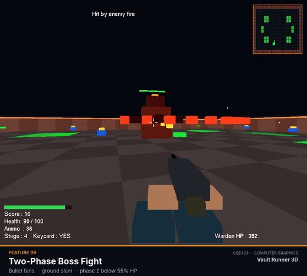

# Vault Runner 3D

**A first-person 3D maze shooter built from raw OpenGL. No game engine.**

[Watch the video](#-watch-it-in-action) · [Features](#-features) · [How it works](#-how-it-works) · [Play it](#-play-it) · [Team](#-team)

## 🎬 Watch it in action

Two minutes, all 9 features, with an original soundtrack (turn the sound on).

https://github.com/user-attachments/assets/b0d7b4f0-2365-45a8-9208-d6491291031d
