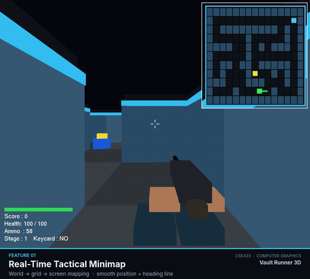
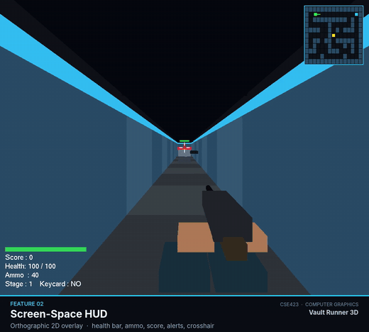
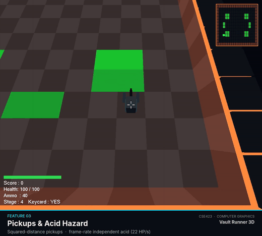
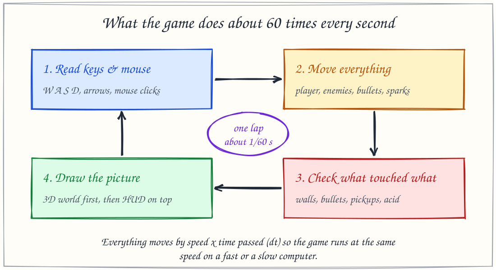
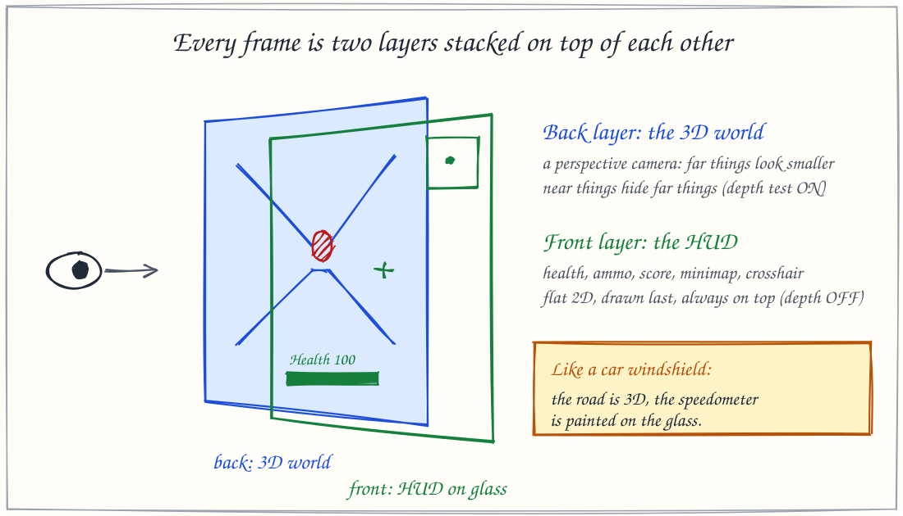
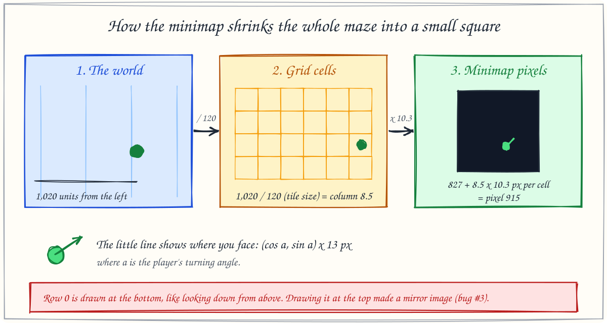
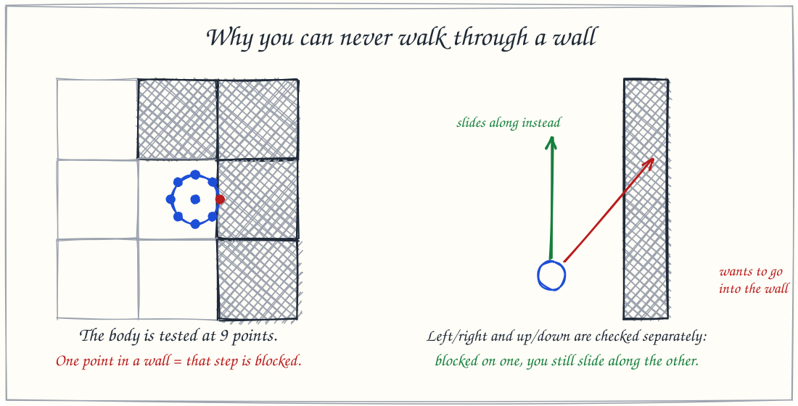
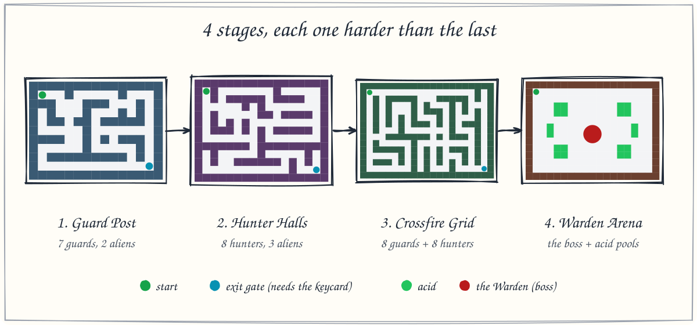
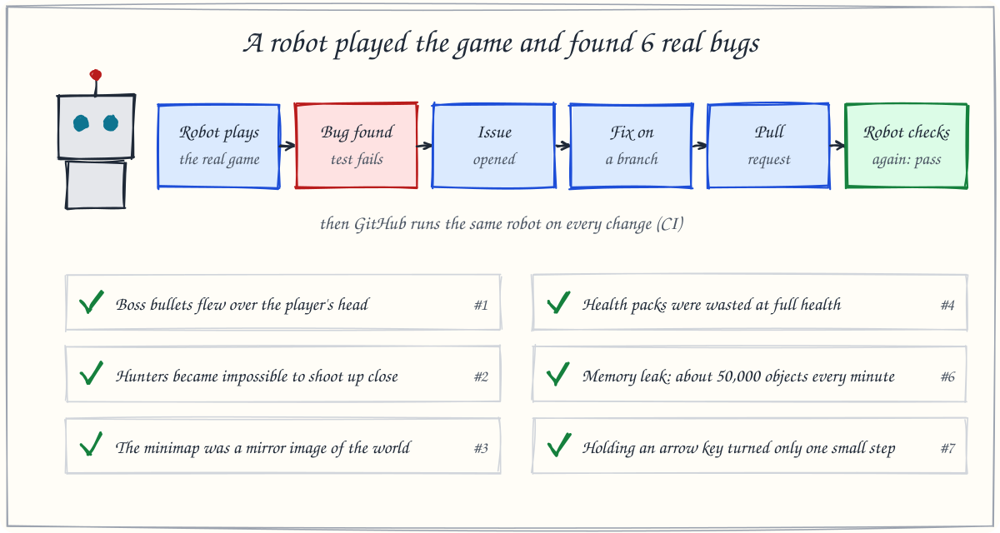

<div align="center">

# Vault Runner 3D

**A first-person 3D maze shooter built from raw OpenGL. No game engine.**

[](https://github.com/YahiaRabbi/vault-runner-3d/actions/workflows/playtest.yml)


[Watch the video](#-watch-it-in-action) · [Features](#-features) · [How it works](#-how-it-works) · [Play it](#-play-it) · [Team](#-team)

</div>

## 🎬 Watch it in action

Two minutes, all 9 features, with an original soundtrack (turn the sound on).

https://github.com/user-attachments/assets/b0d7b4f0-2365-45a8-9208-d6491291031d

## ✨ Why this project is different

| | |
|---|---|
| 🧱 **No game engine** | Every wall, enemy, bullet, camera and HUD element is drawn by hand with OpenGL calls and matrix transforms. No Unity, no Godot, no Pygame. |
| 🤖 **Tested by a robot** | A bot plays the real game headless and checks 33 rules. It found **6 real bugs**, each fixed through an issue and a pull request, and GitHub re-runs it on every change. |
| 🎵 **Even the music is code** | The soundtrack is synthesized from scratch with NumPy, and the beat drop is timed to land on the first frame of the boss fight. |

## 🎮 Features

| Minimap | HUD | Acid hazard |
|---|---|---|
|  |  |  |

| # | Feature | What it does | Clip |
|---|---|---|---|
| 1 | **Real-time tactical minimap** | Shrinks the maze into the corner and tracks you, the keycard and the gate, with a line showing where you face | [▶ 17 s](media/videos/01_real_time_tactical_minimap.mp4) |
| 2 | **Screen-space HUD** | Health bar, ammo, score, alerts and crosshair, painted on a flat 2D layer over the 3D world | [▶ 7 s](media/videos/02_screen_space_hud.mp4) |
| 3 | **Pickups & acid hazard** | Health packs (+25), ammo boxes (+18), and acid that burns exactly 22 HP per second on any computer | [▶ 15 s](media/videos/03_pickups_and_acid_hazard.mp4) |
| 4 | **Maze collision & wall sliding** | A 9-point body test so you never clip into walls, and smooth sliding along them | [▶ 12 s](media/videos/04_maze_collision_and_wall_sliding.mp4) |
| 5 | **Dual camera** | Switch between first person and a third-person camera that lifts itself when a wall is behind you | [▶ 7 s](media/videos/05_dual_camera.mp4) |
| 6 | **Keycard, gate & stages** | Find the keycard to unlock the exit gate and move through 4 stages | [▶ 19 s](media/videos/06_keycard_locked_gate_and_stages.mp4) |
| 7 | **Guard & alien AI** | Scanning turrets that spot you by line of sight and fire on a timer | [▶ 9 s](media/videos/07_guard_and_alien_ai.mp4) |
| 8 | **Hunter AI** | Roam until they see you, then charge; they can respawn on stages 2–3 | [▶ 13 s](media/videos/08_hunter_ai.mp4) |
| 9 | **Two-phase boss fight** | The Warden fires bullet fans and slams the ground, and gets faster below 55% health | [▶ 12 s](media/videos/09_two_phase_boss_fight.mp4) |

## 🧠 How it works

No coding background needed. The full illustrated guide is in **[docs/HOW_IT_WORKS.md](docs/HOW_IT_WORKS.md)**.

**The game is a loop.** About 60 times a second it reads your keys, moves everything, checks collisions, and draws a new picture. Every movement is scaled by the time that passed (`dt`), so the game runs at the same speed on a fast or a slow computer.



**Every frame is two layers:** the 3D world through a perspective camera, then a flat HUD painted on top, like a speedometer on a car windshield.



**The minimap shrinks the world** in two steps: world position ÷ tile size gives a grid cell, and grid cell × pixels per cell gives a minimap pixel.



**Walls are solid** because the player's body is tested at 9 points before every step, and sideways and forward motion are checked separately so you slide along walls.



## 🗺️ Four stages



| Stage | Name | You face |
|---|---|---|
| 1 | Guard Post | 7 guard turrets, 2 aliens |
| 2 | Hunter Halls | 8 hunters that can respawn, 3 aliens |
| 3 | Crossfire Grid | 8 guards and 8 hunters at once, 4 aliens |
| 4 | Warden Arena | The two-phase boss, acid pools, 3 aliens |

## 🤖 Tested by a robot



A playtest bot drives the real game module headless (no window) and checks maze reachability, keycard and gate logic, pickups, frame-rate independent acid damage, shooting, both boss phases, game over and restart, wall collision, held arrow keys, and a 3-minute random-play soak test on every stage.

| Bug the robot found | Fix |
|---|---|
| Boss bullets spawned above the player's hit zone and could never hit ([#1](https://github.com/YahiaRabbi/vault-runner-3d/issues/1)) | [#5](https://github.com/YahiaRabbi/vault-runner-3d/pull/5) |
| Hunters walked into the player's body, where bullets could not reach them ([#2](https://github.com/YahiaRabbi/vault-runner-3d/issues/2)) | [#5](https://github.com/YahiaRabbi/vault-runner-3d/pull/5) |
| The minimap was a mirror image of the world ([#3](https://github.com/YahiaRabbi/vault-runner-3d/issues/3)) | [#5](https://github.com/YahiaRabbi/vault-runner-3d/pull/5) |
| Health packs wasted at full HP; Stage 2 started facing a wall ([#4](https://github.com/YahiaRabbi/vault-runner-3d/issues/4)) | [#5](https://github.com/YahiaRabbi/vault-runner-3d/pull/5) |
| A new GLU quadric leaked on every cylinder draw, about 50,000 per minute ([#6](https://github.com/YahiaRabbi/vault-runner-3d/issues/6)) | [#8](https://github.com/YahiaRabbi/vault-runner-3d/pull/8) |
| Holding an arrow key turned only one small step ([#7](https://github.com/YahiaRabbi/vault-runner-3d/issues/7)) | [#8](https://github.com/YahiaRabbi/vault-runner-3d/pull/8) |

```bash
python tools/playtest/logic_test.py    # 33 gameplay checks
python tools/playtest/boss_test.py     # boss bullets hit the player
python tools/playtest/hunter_test.py   # point-blank hunters can be shot
```

## 🕹️ Play it

```bash
git clone https://github.com/YahiaRabbi/vault-runner-3d.git
cd vault-runner-3d
pip install -r requirements.txt
python vault_runner.py
```

GLUT must be installed too. On Linux: `sudo apt install freeglut3-dev`. On Windows: use the same PyOpenGL + freeglut setup as the CSE423 lab.

| Key | Action |
|---|---|
| `W` `A` `S` `D` | Move and strafe |
| `Q` / `E` or `←` / `→` | Turn |
| `↑` / `↓` | Look up / down |
| `Space` or left click | Shoot |
| `C` or right click | Switch first / third person |
| `G` | Cheat mode (unlimited health and ammo) |
| `R` | Restart |
