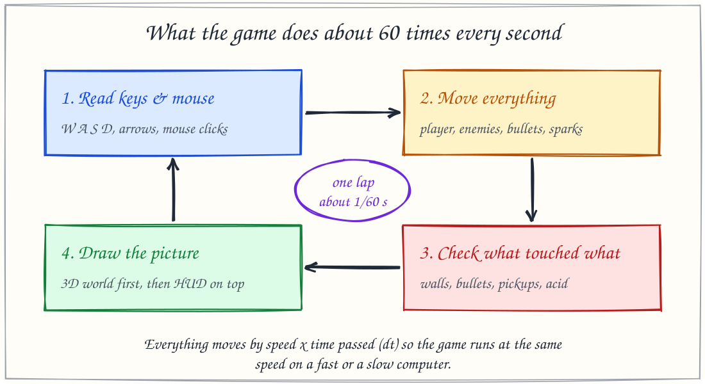
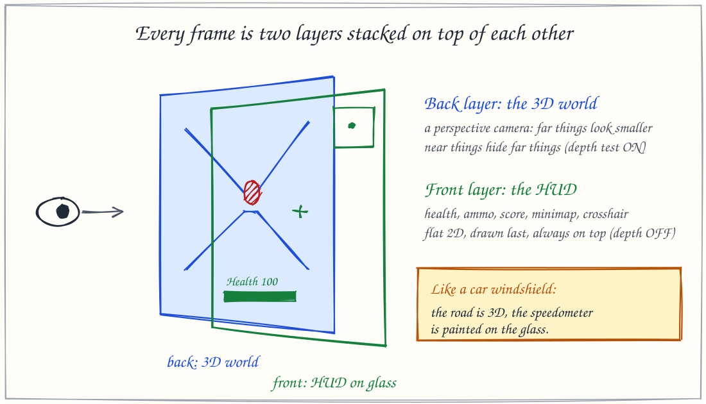

# How Vault Runner 3D works

A plain-language tour of the game, written for anyone who is curious, with no coding background needed. Every picture below is a real description of what the code in [`vault_runner.py`](../vault_runner.py) does.

## 1. The game is a loop

A video game is really a very fast flipbook. About 60 times every second, the game runs the same four steps, then shows you the new picture.

1. **Read the keys.** Which keys are held down right now? Was the mouse clicked?
2. **Move everything.** The player, every enemy, every bullet and every spark takes one small step.
3. **Check what touched what.** Did a bullet hit someone? Did the player walk into a wall, onto a health pack, or into acid?
4. **Draw the picture.** Paint the 3D world, then paint the health bar, ammo and minimap on top.

**Why the game feels the same on every computer:** a fast computer runs the loop more often than a slow one. If everything moved "5 steps per lap", the game would run faster on a fast PC. Instead, every movement is multiplied by **how much time passed since the last lap** (called `dt`, "delta time"). Faster laps means smaller steps, so the speed in real seconds is always the same. The acid, for example, always burns exactly 22 health per second.

## 2. Every frame is two layers

The picture you see is painted in two passes:

- **The 3D world** is painted first, through a *perspective camera*: things far away look smaller, just like in real life. The graphics card keeps a "depth" number for every pixel so that a wall in front correctly hides an enemy behind it.
- **The HUD** (health, ammo, score, crosshair, minimap) is painted last, as a flat 2D layer, like stickers on a window. Depth is switched off for this pass so nothing in the world can ever cover it.

Switching between these two "modes" is done with OpenGL's *projection matrix*: a perspective one for the world (`gluPerspective`), and a flat one that maps straight to screen pixels for the HUD (`gluOrtho2D`).
